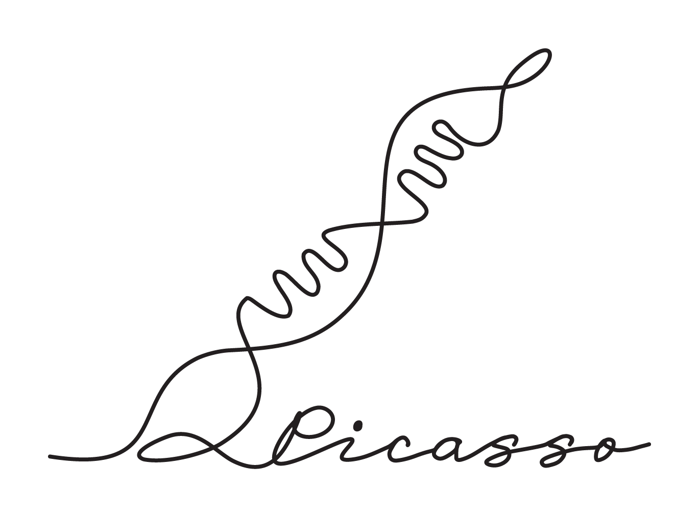

Picasso
=======
.. image:: https://readthedocs.org/projects/picassosr/badge/?version=latest
   :target: https://picassosr.readthedocs.io/en/latest/?badge=latest
   :alt: Documentation Status

.. image:: https://github.com/jungmannlab/picasso/workflows/CI/badge.svg
   :target: https://github.com/jungmannlab/picasso/workflows/CI/badge.svg
   :alt: CI

.. image:: https://img.shields.io/endpoint?url=https://raw.githubusercontent.com/jungmannlab/picasso/badges/coverage-badge.json
   :target: https://github.com/jungmannlab/picasso/actions/workflows/main.yml?query=branch%3Amaster
   :alt: Test coverage

.. image:: http://img.shields.io/badge/DOI-10.1038/nprot.2017.024-52c92e.svg
   :target: https://doi.org/10.1038/nprot.2017.024
   :alt: DOI

.. image:: https://static.pepy.tech/personalized-badge/picassosr?period=total&units=international_system&left_color=black&right_color=brightgreen&left_text=Downloads
   :target: https://pepy.tech/project/picassosr
   :alt: Downloads

.. image:: https://img.shields.io/pypi/pyversions/picassosr
   :target: https://pypi.org/project/picassosr/
   :alt: Python versions

.. image:: https://img.shields.io/pypi/v/picassosr
   :target: https://pypi.org/project/picassosr/
   :alt: PyPI version

.. image:: https://img.shields.io/badge/Changelog-View-blue
   :target: https://github.com/jungmannlab/picasso/blob/master/changelog.md
   :alt: Changelog

|logo|

A collection of tools for painting super-resolution images, covering single-molecule localization microscopy (SMLM) analysis from raw movies to localization, rendering and quantification. Picasso is complemented by our `Nature Protocols publication <https://doi.org/10.1038/nprot.2017.024>`__.

**Documentation:** `picassosr.readthedocs.io <https://picassosr.readthedocs.io/en/latest/>`__ - `Installation <https://picassosr.readthedocs.io/en/latest/getting-started/installation.html>`__, `First steps <https://picassosr.readthedocs.io/en/latest/getting-started/workflow.html>`__, `Python API <https://picassosr.readthedocs.io/en/latest/api/index.html>`__, `Changelog <https://github.com/jungmannlab/picasso/blob/master/changelog.md>`__.

Installation
------------

**Just the GUI** (Windows, macOS): download the one-click installer from the `latest release <https://github.com/jungmannlab/picasso/releases/latest>`__.

**As a Python package** (Windows, macOS, Linux):

.. code-block:: bash

   pip install picassosr
   picasso render  # or localize, filter, design, ...

For GPU support, extra file formats or a developer setup, see the `installation guide <https://picassosr.readthedocs.io/en/latest/getting-started/installation.html>`__.

Example Usage
-------------

Besides the GUI, Picasso can be used like any other Python package::

  from picasso import io, postprocess

  locs, info = io.load_locs("testdata_locs.hdf5")

  # Link localizations and calculate dark times
  linked_locs, linked_info = postprocess.link(
      locs, info, r_max=10, max_dark_time=1
  )
  linked_locs, linked_info = postprocess.compute_dark_times(
      linked_locs, linked_info
  )

  print(f"Average bright time {linked_locs['len'].mean():.2f} frames")
  print(f"Average dark time {linked_locs['dark'].mean():.2f} frames")

For more examples, see the `sample notebooks <https://github.com/jungmannlab/picasso/tree/master/samples>`__ and the `Python API documentation <https://picassosr.readthedocs.io/en/latest/api/index.html>`__.

Contributing
------------

Please post feature requests and bug reports on the `issue tracker <https://github.com/jungmannlab/picasso/issues>`__; pull requests are welcome (see the `contributing guidelines <https://github.com/jungmannlab/picasso/blob/master/CONTRIBUTING.rst>`__). You can also contact us via picasso@jungmannlab.org.

.. SYNC-START: contributions

Contributions & Copyright
-------------------------

| Contributors: Rafal Kowalewski, Maximilian Strauss, Joerg Schnitzbauer, Heinrich Grabmayr, Adrian Przybylski, Alexander Auer and `others <https://github.com/jungmannlab/picasso/graphs/contributors>`__ 
| Copyright (c) 2015-2026 Jungmann Lab, Max Planck Institute of Biochemistry

.. SYNC-END: contributions

.. SYNC-START: citing

Citing Picasso
--------------

If you use Picasso in your research, please cite our Nature Protocols publication describing the software.

| J. Schnitzbauer*, M.T. Strauss*, T. Schlichthaerle, F. Schueder, R. Jungmann
| Super-Resolution Microscopy with DNA-PAINT
| Nature Protocols (2017). 12: 1198-1228 DOI: `10.1038/nprot.2017.024 <https://doi.org/10.1038/nprot.2017.024>`__

Many of the functionalities provided by Picasso were published independently, please also cite the respective publications:

.. list-table::
   :widths: 40 30 30
   :header-rows: 1

   * - Feature
     - Citation
     - DOI
   * - Fitting. All methods are ports of Gpufit, see the `Gpufit license <https://github.com/jungmannlab/picasso/blob/master/LICENSES/Gpufit-LICENSE.txt>`__
     - Przybylski et al., Sci. Rep., 2017
     - `10.1038/s41598-017-15313-9 <https://doi.org/10.1038/s41598-017-15313-9>`__
   * - Experimental PSF (cubic-spline) fitting. The calibration follows the coefficient scheme of Gpuspline, see the `Gpuspline license <https://github.com/jungmannlab/picasso/blob/master/LICENSES/Gpuspline-LICENSE.txt>`__
     - Li et al., Nat. Methods, 2018; Babcock & Zhuang, Sci. Rep., 2017
     - `10.1038/nmeth.4661 <https://doi.org/10.1038/nmeth.4661>`__, `10.1038/s41598-017-00622-w <https://doi.org/10.1038/s41598-017-00622-w>`__
   * - Multichannel (global) experimental-PSF fitting (globLoc)
     - Li et al., Nat. Commun., 2022
     - `10.1038/s41467-022-30719-4 <https://doi.org/10.1038/s41467-022-30719-4>`__
   * - 3D fitting via astigmatism
     - Huang et al., Science, 2008
     - `10.1126/science.1153529 <https://www.science.org/doi/10.1126/science.1153529>`__
   * - Magnification factor of z (refractive-index mismatch, ``Calculate...``)
     - Loginov et al., Optica, 2024; Lyakin et al., Opt. Spectrosc., 2017
     - `10.1364/OPTICA.520595 <https://doi.org/10.1364/OPTICA.520595>`__, `10.1134/S0030400X17090235 <https://doi.org/10.1134/S0030400X17090235>`__
   * - B-spline wavelet spot identification
     - Izeddin et al., Opt. Express, 2012
     - `10.1364/OE.20.002081 <https://doi.org/10.1364/OE.20.002081>`__
   * - Multi-emitter fitting (3D-DAOSTORM). A port of storm-analysis, see the `storm-analysis license <https://github.com/jungmannlab/picasso/blob/master/LICENSES/storm-analysis-LICENSE.txt>`__; its spline PSF is implemented from the paper
     - Babcock et al., Opt. Nanoscopy, 2012; Babcock & Zhuang, Sci. Rep., 2017
     - `10.1186/2192-2853-1-6 <https://doi.org/10.1186/2192-2853-1-6>`__, `10.1038/s41598-017-00622-w <https://doi.org/10.1038/s41598-017-00622-w>`__
   * - sCMOS pixel-dependent noise modeling
     - Huang et al., Nat. Methods, 2013
     - `10.1038/nmeth.2488 <https://doi.org/10.1038/nmeth.2488>`__
   * - NeNA
     - Endesfelder et al., Histochem. Cell Biol., 2014
     - `10.1007/s00418-014-1192-3 <https://doi.org/10.1007/s00418-014-1192-3>`__
   * - FRC
     - Nieuwenhuizen et al., Nat. Methods, 2013
     - `10.1038/nmeth.2448 <https://doi.org/10.1038/nmeth.2448>`__
   * - Decorrelation analysis
     - Descloux et al., Nat. Methods, 2019
     - `10.1038/s41592-019-0515-7 <https://doi.org/10.1038/s41592-019-0515-7>`__
   * - Bilinear rendering and pixel size for decorrelation analysis of SMLM data
     - Descloux et al., Commun. Biol., 2021
     - `10.1038/s42003-021-02086-1 <https://doi.org/10.1038/s42003-021-02086-1>`__
   * - Theoretical lateral localization precision (``lpx`` / ``lpy``, Gaussian least-squares)
     - Mortensen et al., Nat. Methods, 2010
     - `10.1038/nmeth.1447 <https://doi.org/10.1038/nmeth.1447>`__
   * - Theoretical axial localization precision (``lpz``, Gaussian)
     - Kowalewski et al., Nat. Commun., 2026
     - `10.1038/s41467-026-70198-5 <https://doi.org/10.1038/s41467-026-70198-5>`__
   * - Theoretical lateral localization precision of overlapping emitters (``lpx`` / ``lpy``, multi-emitter fitting)
     - Huang et al., Biomed. Opt. Express, 2011
     - `10.1364/BOE.2.001377 <https://doi.org/10.1364/BOE.2.001377>`__
   * - Quad-tree adaptive histogram rendering
     - Baddeley et al., Microsc. Microanal., 2010
     - `10.1017/S143192760999122X <https://doi.org/10.1017/S143192760999122X>`__
   * - RCC undrifting
     - Wang et al., Opt. Express, 2014
     - `10.1364/OE.22.015982 <https://doi.org/10.1364/OE.22.015982>`__
   * - AIM undrifting. Adapted from the authors' code, see the `AIM license <https://github.com/jungmannlab/picasso/blob/master/LICENSES/AIM-LICENSE.txt>`__
     - Ma et al., Sci. Adv., 2024
     - `10.1126/sciadv.adm7765 <https://www.science.org/doi/10.1126/sciadv.adm7765>`__
   * - SMLM clusterer
     - Schlichthaerle et al., Nat. Commun., 2021; Reinhardt et al., Nature, 2023
     - `10.1038/s41467-021-22606-1 <https://doi.org/10.1038/s41467-021-22606-1>`__, `10.1038/s41586-023-05925-9 <https://doi.org/10.1038/s41586-023-05925-9>`__
   * - DBSCAN
     - Ester et al., KDD, 1996 (Vol. 96, No. 34, pp. 226-231)
     - -
   * - Anisotropic DBSCAN (inspired by)
     - Lörzing et al., J. Phys. Chem. B, 2024
     - `10.1021/acs.jpcb.4c02030 <https://doi.org/10.1021/acs.jpcb.4c02030>`__
   * - HDBSCAN
     - Campello et al., PAKDD, 2013
     - `10.1007/978-3-642-37456-2_14 <https://doi.org/10.1007/978-3-642-37456-2_14>`__
   * - RESI
     - Reinhardt et al., Nature, 2023
     - `10.1038/s41586-023-05925-9 <https://doi.org/10.1038/s41586-023-05925-9>`__
   * - Nanotron
     - Auer et al., Bioinformatics, 2020
     - `10.1093/bioinformatics/btaa154 <https://doi.org/10.1093/bioinformatics/btaa154>`__
   * - Picasso Server
     - Strauss, Commun. Biol., 2022
     - `10.1038/s42003-022-03909-5 <https://doi.org/10.1038/s42003-022-03909-5>`__
   * - SPINNA
     - Masullo et al., Nat. Commun., 2025
     - `10.1038/s41467-025-59500-z <https://doi.org/10.1038/s41467-025-59500-z>`__
   * - SPINNA for labeling efficiency (LE) fitting
     - Hellmeier et al., Nat. Methods, 2024
     - `10.1038/s41592-024-02242-5 <https://doi.org/10.1038/s41592-024-02242-5>`__
   * - G5M
     - Kowalewski et al., Nat. Commun., 2026
     - `10.1038/s41467-026-70198-5 <https://doi.org/10.1038/s41467-026-70198-5>`__
   * - Coordinate-based colocalization (CBC)
     - Malkusch et al., Histochem. Cell Biol., 2012
     - `10.1007/s00418-011-0880-5 <https://doi.org/10.1007/s00418-011-0880-5>`__
   * - Ripley's K and H functions
     - Ripley, J. R. Stat. Soc. B, 1977
     - `10.1111/j.2517-6161.1977.tb01615.x <https://doi.org/10.1111/j.2517-6161.1977.tb01615.x>`__
   * - Two-channel (cross) Ripley's H and radial distribution functions
     - Lotwick and Silverman, J. R. Stat. Soc. B, 1982
     - `10.1111/j.2517-6161.1982.tb01221.x <https://doi.org/10.1111/j.2517-6161.1982.tb01221.x>`__
   * - Distances to the k-th nearest neighbors for random positions
     - Thompson, Ecology, 1956
     - `10.2307/1933159 <https://doi.org/10.2307/1933159>`__
   * - Edge-corrected (Kaplan-Meier) nearest neighbor distance distributions
     - Baddeley and Gill, Ann. Stat., 1997
     - `10.1214/aos/1034276629 <https://doi.org/10.1214/aos/1034276629>`__
   * - Stitching tiles (global tile positions, inspired by)
     - Preibisch et al., Bioinformatics, 2009
     - `10.1093/bioinformatics/btp184 <https://doi.org/10.1093/bioinformatics/btp184>`__
   * - Single-particle tracking (nearest-neighbor tracking, jump distance and MSD analysis)
     - Martens et al., Front. Bioinform., 2021
     - `10.3389/fbinf.2021.817254 <https://doi.org/10.3389/fbinf.2021.817254>`__

.. SYNC-END: citing

.. SYNC-START: credits

Credits
-------

-  Design icon based on "Hexagon" by Creative Stall from the Noun Project
-  Simulate icon based on "Microchip" by Futishia from the Noun Project
-  Localize icon based on "Mountains" by MONTANA RUCOBO from the Noun Project
-  Filter icon based on "Funnel" by José Campos from the Noun Project
-  Render icon based on "Paint Palette" by Vectors Market from the Noun Project
-  Average icon based on "Layers" by Creative Stall from the Noun Project
-  Server icon based on "Database" by Nimal Raj from the Noun Project
-  SPINNA icon based on "Spinner" by Viktor Ostrovsky from the Noun Project
-  The Noun Project icons above are used under the `CC BY 3.0 <https://creativecommons.org/licenses/by/3.0/>`__ license.
-  Toolbar and menu icons from `Lucide <https://lucide.dev>`__ (ISC license). License can be found `here <https://github.com/jungmannlab/picasso/blob/master/LICENSES/Lucide-LICENSE.txt>`__.

.. SYNC-END: credits
